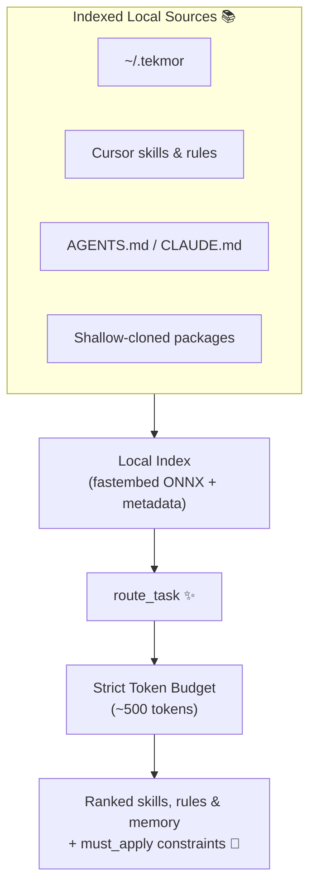

every coding agent turn arrives with too much context and not enough signal ✨.

your skills folders, rule files, agent personas, and past project notes all fight for the exact same tiny token window. cloud memory SaaS adds network lag, expensive subscription tiers, and another vendor to worry about. and just dumping everything into your system prompt? that melts your context window before you even write a single line of code 💀.

so i had a blast building [tekmor](https://github.com/autonomic-ai-dev/tekmor) 🤍! it's a **local MCP server written in Rust** that lives right on your machine. it indexes your local skills, rules, and notes, and answers one simple question on every single turn:

**what should the model see right now under a strict token budget?**

`route_task` returns ranked skills, rules, and memory packed neatly into a ~500-token envelope. memory writes go through SQLite WAL. and the best part? nothing ever leaves your machine unless you want it to 🚀!

---

## the problem it solves (say goodbye to context bloat ☕)

coding agents already have skills folders and `.cursorrules`. the failure mode is almost never missing content — it is **ungoverned retrieval**:

- the model loads 5 irrelevant skills that crowd out your actual code.
- rules repeat every single turn until the prompt runs out of memory.
- old facts contradict today's refactored architecture.
- there's no durable write path for decisions you want to remember next week.

`tekmor` isn't an overcomplicated agent framework. it doesn't try to replace your LLM or plan 50-step tasks. it is simply a **routing layer**: cheap, local, and friendly ✨.

---

## how the architecture works at a glance 🚢



indexed sources include:

| source | where it lives |
|---|---|
| brain home | `~/.tekmor/{rules,skills,agents}/` |
| Cursor | `~/.cursor/skills/`, `.cursor/rules/` |
| Claude / Codex | `~/.claude/`, `~/.codex/` |
| repo roots | `AGENTS.md`, `CLAUDE.md` |
| skill packs | `~/.tekmor/packages/` |

skill packs work like lightweight plug-in packs. running `tekmor add owner/repo` shallow-clones community skill packs into your brain home so you don't have to copy-paste markdown into twenty different git repositories!

---

## `route_task`: your turn's best friend 🤝

at the start of every turn, the editor calls **`route_task`** with:
- the user's message
- current working directory
- active open files

in return, `tekmor` gives you:
- `recommended_skills` & `applicable_rules` (ranked by relevance!)
- `must_apply` — non-negotiable constraints that must not be skipped
- `tokens_used` & `latency_ms` (usually <15ms!)

an in-memory LRU cache makes repeated questions in the same session feel instant. routing is so fast you won't even notice it happened before the model starts streaming tokens ✨.

---

## why we chose Rust + MCP 🦀

the Model Context Protocol fits modern coding tools like a glove: JSON-RPC over stdout, a long-lived supervisor process, and stderr for logs.

Rust gives us three huge superpowers:
1. **instant cold starts** once the embedding model loads in memory.
2. **SQLite WAL** so concurrent reads never block your background writes.
3. **a single featherlight binary** that drinks almost zero RAM.

the first time you run it, `tekmor` pulls down the friendly little `AllMiniLML6V2` embedding model (~90MB) via fastembed. from then on, all vector similarity calculations run completely offline right on your CPU or Apple Silicon Neural Engine 🚀.

---

## keeping memory clean: the write path 🤍

when an agent finishes a tricky bug fix or architectural decision, it calls `store_memory`:

```bash
tekmor store_memory --topic "database" --fact "We use goose migrations in migrations/*.sql"
```

writes are serialized through a single-threaded queue so SQLite never throws a locking fit.

and if you want to inspect what your agent knows?
- `tekmor list_memory` shows your saved facts.
- `tekmor explain_last_context` tells you exactly why a rule was chosen on the last turn!

---

## wrapping up

building `tekmor` made my daily pairing sessions with AI agents feel so much cleaner. no more 20-page prompt dumps, no cloud subscription latency, just crisp, relevant context on every turn.

the project is completely open source under MIT at [github.com/autonomic-ai-dev/tekmor](https://github.com/autonomic-ai-dev/tekmor).

in [Part 2 of the series](/blog/agent-brain-memory-scopes-and-reinforcement/), we explore scoped memory, temporal decay, and how to teach agents to forget stale workarounds!

hope you enjoy it, and happy hacking 🤍!
