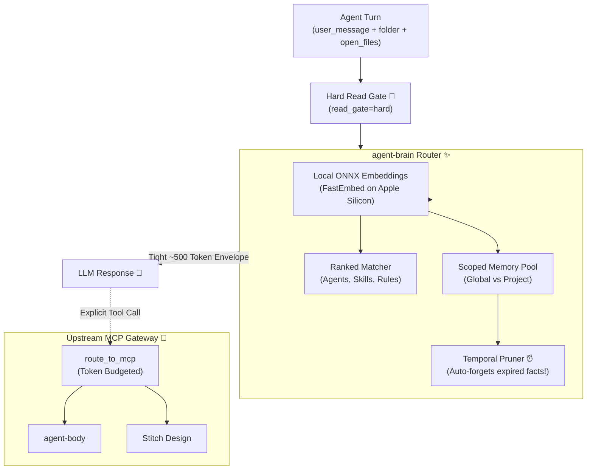

in [Part 1 of our agent-brain series](/blog/agent-brain-local-mcp-routing/), we built a neat local Rust MCP server to solve one simple question for coding agents: **what should the model see right now under a strict token budget?**

and in the first few weeks, it was such a breath of fresh air!

but as we used it every day across dozens of different repos, our little memory store began acting like an overstuffed attic 💀.
- facts that were true on Tuesday became completely wrong on Thursday after a dependency update.
- a rule about `bun test` in our web frontend kept getting injected into our Python machine learning repos.
- our poor agent was drowning in yesterday's temporary workarounds!

so today, i wanted to share how we gave [agent-brain](https://github.com/autonomic-ai-dev/agent-brain) a clean memory taxonomy: **project vs global scopes**, **expiration dates for facts**, and **cross-client memory sharing** between Cursor, Antigravity, and Gemini ✨!

---

## the updated routing loop at a glance 🚢

here's how `agent-brain` routes context today before any prompt hits the model:



---

## 1. scoped memory: global habits vs project secrets 🤍

not every piece of advice belongs in every folder!

if an agent figures out that our Astro blog needs `bun test`, injecting that into an enterprise Java Spring Boot backend just wastes precious prompt tokens and confuses the model.

so we partitioned memory in Rust into two clean scopes:

```rust
#[derive(Debug, Clone, Serialize, Deserialize)]
pub enum MemoryScope {
    Global,
    Project { root_hash: String },
}

pub struct MemoryFact {
    pub id: Uuid,
    pub topic: String,
    pub fact: String,
    pub scope: MemoryScope,
    pub confidence: f32,
    pub polarity: Option<FactPolarity>,
    pub valid_from: Option<i64>,
    pub invalid_at: Option<i64>,
}
```

- **`global`**: your universal developer preferences! things like *"prefer pure functions"*, *"handle errors with explicit enums"*, or *"never leave debugging print statements behind"*. these follow you across every workspace.
- **`project`**: strictly tied to the unique Git root hash of the repository you're standing in right now. build flags, test commands, and specific file path conventions live here safely.
- **`polarity`**: a fun little feature that flags anti-patterns! if an agent tries a CLI flag that blew up with a non-zero exit code yesterday, we record it with negative polarity: *"Don't try `--experimental-flag` here again; it fails on Node v22."* the agent never repeats the same mistake twice 🚀!

---

## 2. temporal pruning: teaching agents to forget ⏰

static memory stores turn into messy junk drawers very quickly.

temporary build workarounds (like *"pass `--legacy-peer-deps` until the upstream package updates next week"*) will haunt your agent for months if you don't give them an expiration date:

```json
{
  "topic": "astro-upgrade-temporary-flag",
  "fact": "Use --legacy-peer-deps until sharp 0.35 is released",
  "confidence": 0.85,
  "valid_from": 1781700000000,
  "invalid_at": 1782500000000
}
```

on every single turn, `agent-brain` checks `invalid_at`. if the timestamp has passed, the fact gets gently archived. unverified claims decay naturally, while battle-tested recipes that repeatedly pass verification get a confidence boost ✨.

---

## 3. cross-session memory: jump between tools without losing context 🤝

like most developers, i don't live in just one tool:
- i might sketch an architecture plan with Gemini in the terminal.
- jump into Cursor or Antigravity to write the implementation.
- and do final review in a separate CLI session.

`agent-brain` periodically reads session logs from local transcripts (`~/.cursor/.../transcript.jsonl` and `~/.gemini/antigravity-cli/...`), condenses the core actions into a 150-token summary, and makes it available immediately in your other windows:

> *"Retrieved via route_task (Gemini, 2 turns ago): Redesigned the blog navbar and bumped Node to v24.22.1."*

no more copy-pasting conversation summaries across chat windows 🤍!

---

## 4. the `route_to_mcp` gateway 🌐

as the Model Context Protocol ecosystem exploded, connecting 15 different MCP servers directly to your editor became a recipe for token bankruptcy before you even started typing.

`agent-brain` acts as a calm gateway:
- upstream tools (like `agent-body` for sandboxed commands or Google `stitch` for UI screens) register behind `agent-brain`.
- the model calls `route_to_mcp` with an explicit `max_tokens` ceiling.
- massive JSON payloads get trimmed before hitting your model's context window.

---

## wrapping up

giving agents a way to organize their thoughts and forget old mistakes turned our autonomous coding assistants from clumsy interns into sharp, reliable pairing buddies 🤍.

all the code is open source at [github.com/autonomic-ai-dev/agent-brain](https://github.com/autonomic-ai-dev/agent-brain).

in [Part 3](/blog/agent-brain-the-architectural-pivot-and-runtime/), we'll talk about the biggest pivot of all: why passive advice wasn't enough, and how hard execution gates made agent development reliable again!

what's your favorite little memory trick for coding agents? let me know in the replies ✨!
