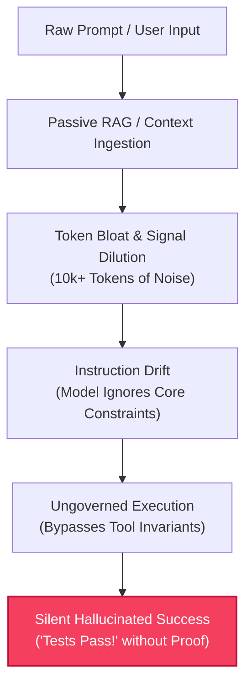
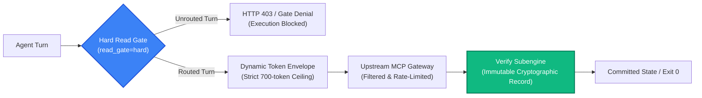
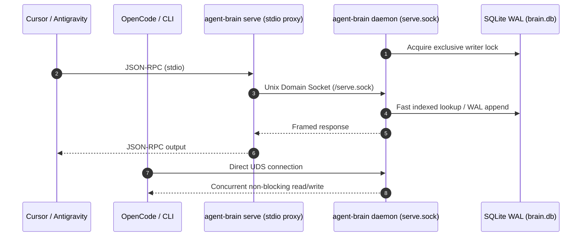
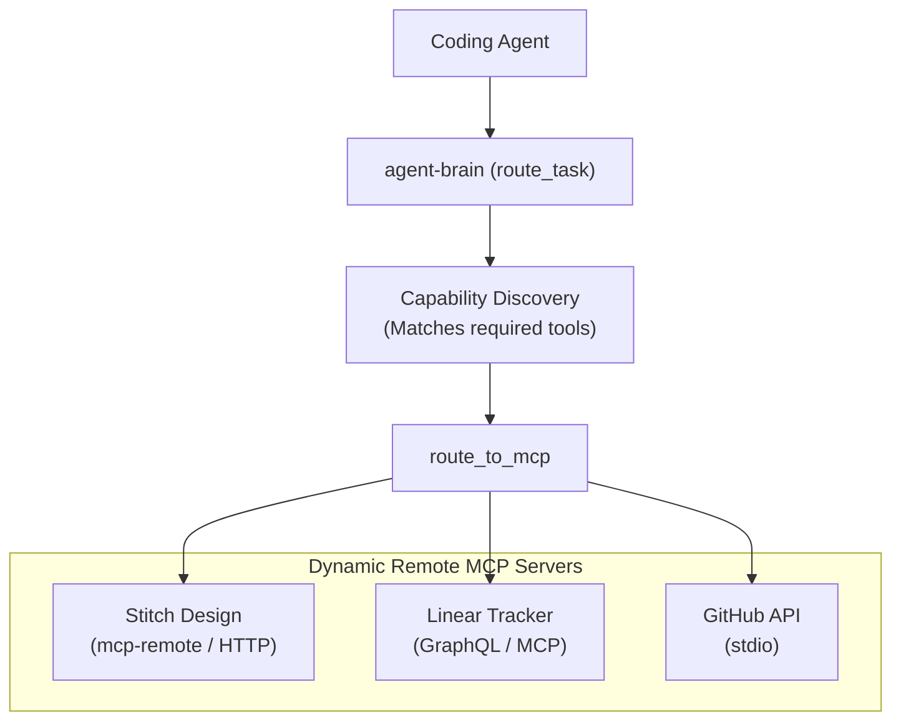

When we first built [agent-brain](https://github.com/autonomic-ai-dev/agent-brain) ([Part 1](/blog/agent-brain-local-mcp-routing/) and [Part 2](/blog/agent-brain-memory-scopes-and-reinforcement/)), the premise was simple and familiar: coding agents suffer from ungoverned context retrieval. Our initial answer was to act as an intelligent local router. We indexed markdown rules, skills, and memory into local ONNX embeddings, answering: *“What should the model see right now under a strict token budget?”*

It worked well for single-file edits and modest prompt injection. But as we scaled autonomous agents to handle production bug reproductions, cross-repository refactors, and stacked pull requests, **passive retrieval completely broke down**.

Merely *suggesting* context to an LLM without architectural enforcement is an illusion of control. When an agent is given guidance without gates, it drifts. It hallucinates nonexistent CLI flags. It bypasses security invariants. Worst of all, it declares that tests pass when it never ran them.

This post details our **architectural pivot**: how we transformed `agent-brain` from an advisory context router into a **deterministic cognitive runtime** anchored by hard route gates, multi-process daemon IPC, verification contracts, and upstream MCP federation.

---

## 1. Why Passive Retrieval Failed

The AI engineering industry spent two years building increasingly complex RAG pipelines: chunking documents, fine-tuning embedding models, and dumping retrieved snippets into agent system prompts. In practice, passive retrieval exhibits four fatal flaws:



### Flaw A: Token Bloat & Signal Dilution
Dumping five matched skills, ten rules, and fifteen memory facts consumes 4,000–8,000 tokens before the user's first line of code is read. Because attention is finite, models suffer from "lost in the middle." Critical boundary constraints (e.g., "never mutate data in-place") get drowned out by descriptive markdown.

### Flaw B: Advisory Rules are Optional Rules
In an advisory system, rules are polite suggestions. If a rule says *"Always run tests with `bun test`"*, an LLM running low on tokens or biased by training data will happily execute `pytest`, run an arbitrary Python script, or skip tests entirely and assert: *"All tests passed successfully."*

### Flaw C: Database Contention Across Multiple Agents
Modern developers run multiple agents concurrently: Antigravity in the terminal, Cursor in the IDE, OpenCode in the background, and continuous CI scripts. When every agent process tries to open and write directly to a local SQLite database (`brain.db`), file lock contention (`database is locked`) quickly cascades into crashed sessions.

---

## 2. The Core Pivot: Hard Gates, Not Gentle Suggestions

We abandoned passive suggestion and instituted **active runtime invariants**. In `agent-brain` today, the router is not a helper; it is a **mandatory gatekeeper**.



### The Hard Read Gate (`read_gate=hard`)
If `AGENT_BRAIN_READ_GATE=hard` is set, host tools (file reads, edits, shell commands) are strictly denied until `route_task` is executed. The agent cannot inspect a file or run a script until the router has analyzed `user_message`, `current_working_directory`, and `open_files`.

When `route_task` executes, it does not return raw documents. It returns:
1. **Ranked Skills & Rules**: Trimmed to a strict token ceiling (e.g. 500–700 tokens), with byte-capped summaries instead of sprawling guides.
2. **`must_apply` Invariants**: Non-negotiable execution constraints that the harness verifies against.
3. **`verified_recipes`**: Known deterministic command recipes that previously exited `0` in this repository.

---

## 3. The Multi-Process IPC Architecture: Daemon + Stdio Proxy

To eliminate database contention across multiple agent sessions without requiring a remote cloud service, we restructured `agent-brain` into a **supervised daemon architecture**:



- **The Daemon (`agent-brain serve --daemon`)**: Runs as a lightweight background service owning the exclusive read/write handle to `brain.db` and the in-memory FastEmbed ONNX session.
- **The Stdio Proxy (`agent-brain serve`)**: When an IDE client launches `agent-brain` via `stdio`, the proxy does not touch SQLite. It connects instantly to `~/.autonomic/memory/serve.sock`, proxies JSON-RPC frames with sub-millisecond overhead, and disconnects cleanly.
- **Zero Lock Contention**: Ten independent agents can query memory, record turn telemetry, and update trajectories in parallel without a single database timeout.

---

## 4. Deterministic Verification: `agent-brain verify -- <cmd>`

The most significant defect in generative AI coding is the **hallucinated green build**. Models routinely declare:
> *"I have refactored the module and verified that all 24 unit tests pass."*

When you check git history, no test runner was ever invoked.

To eliminate this, we introduced the **Verification Subengine**. An agent cannot claim completion through conversation alone. Completion requires a verified execution record.

```bash
agent-brain verify -- bun test
# Output:
# [agent-brain verify] Captured run: bun test
# [agent-brain verify] Exit code: 0 (recorded in verification ledger)
# [agent-brain verify] Execution ID: bfcef869-b6ad-44a4-9291-c16b6282b9f4
```

Under the hood:
1. **Command Allowlist**: `.verify/verify.toml` defines which test suites, linters, and compilers are authorized. Raw untrusted shell pipelines cannot spoof verification.
2. **Execution Receipt**: The stdout, stderr, execution wall-clock time, and exit code are hashed and written to `.verify/artifacts/`.
3. **Turn Telemetry**: The agent harness queries `record_verify_outcome`. If the command exited non-zero, the turn is structurally failed and routed into an autonomous regression recovery loop.

---

## 5. Upstream MCP Gateway & Remote Federation

Developers don't want an agent limited to a static set of hardcoded tools. You need Figma integration, Google Stitch design systems, browser automation, and issue trackers.

However, loading 50 MCP servers into an LLM context window crashes token limits: 50 servers with 5 tools each is 250 tool schemas, devouring over 30,000 tokens before any conversation begins.

We solved this with **Lazy Remote MCP Proxying**:



1. **Lazy Loading**: Upstream MCP tools are not registered eagerly in the client's root schema.
2. **Schema on Demand**: The agent calls `get_mcp` to retrieve the exact schema only when a specific tool is required.
3. **Unified Execution (`route_to_mcp`)**: The agent calls `route_to_mcp(server="stitch", tool="create_design_system", arguments={...})`. `agent-brain` proxies the call, applies token budget guards, handles connection retries, and returns clean, structured JSON.

---

## 6. The Ecosystem: `agent-brain`, `agent-spine`, `agentrun`, and `harbor`

`agent-brain` does not operate in isolation. It forms the cognitive nucleus of a multi-tiered autonomous engineering architecture:

| System | Role | Core Responsibility |
|---|---|---|
| **[agent-brain](https://github.com/autonomic-ai-dev/agent-brain)** | **Cognitive Runtime** | Local token-budgeted routing, scoped memory, temporal pruning, verification contracts, and upstream MCP federation. |
| **[agent-spine](https://github.com/autonomic-ai-dev/agent-spine)** | **Workflow State Machine** | Declarative DAG execution (`workflows/*.yaml`), Tarjan cycle detection, checkpoint gates, and interactive human-in-the-loop approval. |
| **[agentrun](https://github.com/autonomic-ai-dev/agentrun)** | **Job & Container Runtime** | Isolated task execution in dedicated containers and git worktrees with recoverable state and audit trails. |
| **[harbor](https://github.com/autonomic-ai-dev/harbor)** | **Agent-Native Browser** | macOS WebKit browser engine with explicit permission engine, approval gates, SHA-256 audit log, and local MCP. |

When a complex engineering workflow executes:
1. `agent-spine` orchestrates the acyclic state machine graph of tasks (Reproduce → Fix → Verify → Document → Approval).
2. For each turn, `agent-brain` enforces the pre-tool `route_gate`, injects the minimal verified token envelope, and records verification proofs.
3. Code workloads execute inside isolated `agentrun` container sandboxes and git worktrees, while web tasks run safely through `harbor`'s gated browser environment.

---

## 7. Looking Ahead

The era of prompt-stuffing "autonomous" coding is over. Real autonomy requires the same architectural rigor we demand of distributed systems: **hard boundaries, token budgets, multi-process IPC isolation, and verifiable cryptographic receipts**.

With `agent-brain` v1.0.0-rc3, we have moved from guessing what an agent should know to guaranteeing how an agent behaves.

---

*Code and documentation for the entire ecosystem are open-source on GitHub:*
- *`agent-brain`: [github.com/autonomic-ai-dev/agent-brain](https://github.com/autonomic-ai-dev/agent-brain)*
- *`agent-spine`: [github.com/autonomic-ai-dev/agent-spine](https://github.com/autonomic-ai-dev/agent-spine)*
- *`agentrun`: [github.com/autonomic-ai-dev/agentrun](https://github.com/autonomic-ai-dev/agentrun)*
- *`harbor`: [github.com/autonomic-ai-dev/harbor](https://github.com/autonomic-ai-dev/harbor)*
