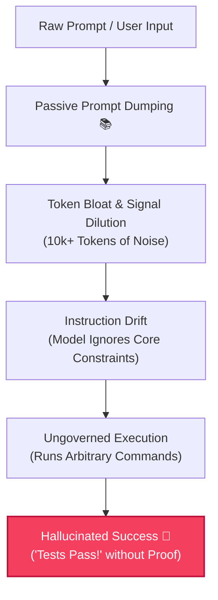
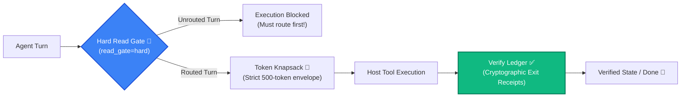
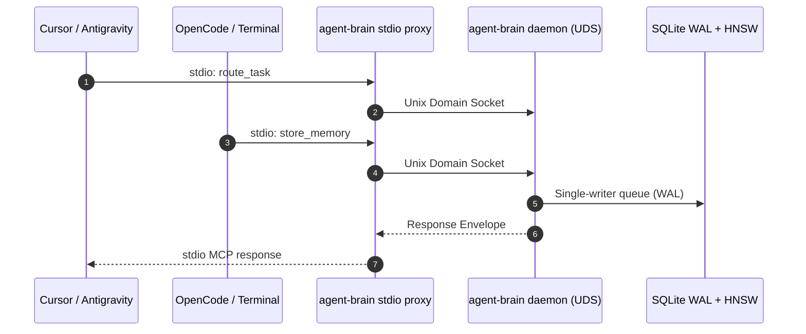

when we first started hacking on [agent-brain](https://github.com/autonomic-ai-dev/agent-brain) ([Part 1](/blog/agent-brain-local-mcp-routing/) and [Part 2](/blog/agent-brain-memory-scopes-and-reinforcement/)), our premise was so innocent and simple:  
*"hey, coding agents suffer from too much context! let's index all our markdown rules, skills, and memory into local ONNX embeddings and politely suggest what the model should look at 🤍."*

and for small single-file edits? it worked nicely!

but as soon as we started asking agents to do real, meaty engineering tasks — reproducing production bugs, doing multi-crate refactors, and writing stacked PRs — **passive suggestions completely broke down 💀**.

turns out, merely *suggesting* guidelines to an LLM without architectural guardrails is pure wishful thinking. when an agent is given polite advice without strict gates, it drifts. it invents CLI flags that don't exist. it skips safety checks. and the most classic move of all? it confidently declares *"All 48 tests have passed successfully!"* when it literally never ran the test runner in the first place 🤡.

here's the story of our big architectural pivot: how we evolved `agent-brain` from a friendly advisory helper into a **deterministic cognitive runtime** in Rust with hard pre-tool gates, token knapsacks, and cryptographic verification receipts ✨!

---

## why polite suggestions failed in the real world ☕

the whole industry spent the last two years building elaborate RAG pipelines: chunking markdown files, tweaking embeddings, and dumping 10,000 tokens of context into the system prompt.

in daily engineering practice, dumping context like that runs straight into three hilarious failure modes:



### 1. the "lost in the middle" attention fog
if you dump 5 skills, 10 rules, and 20 memory facts into the prompt, you've burned 6,000 tokens before the model even reads the user's code! the crucial constraint (like *"never touch the production database"* or *"always use bun test"*) gets completely drowned out by walls of text.

### 2. advisory rules are treated as optional suggestions
if a rule politely asks *"Please run tests using `bun test`"*, an LLM running low on tokens or trained on random Python repos will happily run `pytest`, invent a script, or just hallucinate that everything passed. treat your agents like enthusiastic puppy engineers: give them lots of love, strict compilers, and firm fences 🚀!

### 3. database locking chaos across tools
developers jump between tools constantly: Cursor in the IDE, Antigravity in the terminal, OpenCode in the background. when 3 different agents try to write to a single local SQLite database at the exact same second? boom: `database is locked` errors and crashed sessions everywhere.

---

## the core pivot: hard gates, not gentle suggestions ✨

we threw away gentle suggestions and introduced **hard execution invariants**. in `agent-brain` today, the router is no longer an advisory assistant — it is an unapologetic gatekeeper:



### the hard read gate (`read_gate=hard`)
when you enable `read_gate=hard`, your host editor tools (file reading, editing, bash execution) are locked down until `route_task` is called. the agent literally cannot touch your filesystem until the router has inspected the current turn!

and when `route_task` answers? it doesn't dump huge markdown essays. it packs a tight **~500-token knapsack envelope**:
- byte-capped summaries of only the rules that apply right now.
- `must_apply` execution invariants.
- verified command recipes that previously succeeded in this repository.

---

## multi-process peace: the daemon + stdio proxy 🚢

to solve database locking once and for all, we split `agent-brain` into a supervised background daemon and featherlight stdio proxies:



now you can have 5 agents running across 5 windows, and every single memory write and task route goes through a dedicated Unix Domain Socket (`/tmp/agent-brain.sock`) with zero file lock contention ✨!

---

## `agent-brain verify`: real test receipts, zero hallucinated passes 🛡️

my favorite feature we built is the verification ledger.

whenever an agent claims a task is complete, we don't take its word for it. the agent has to execute:

```bash
agent-brain verify -- bun test
```

`agent-brain verify` spawns an isolated subshell, captures the true process exit code, calculates a SHA-256 hash of the command output, and writes an immutable receipt to the local ledger.

if the command exits non-zero or the tests fail, the receipt records the failure. the agent literally cannot fake a test pass. it brought sanity and trust back into our autonomous coding loops 🤍!

---

## wrapping up

building this pivot taught me that autonomous agents don't need longer prompts or more markdown files — they need clean, deterministic boundaries and verifiable feedback loops.

it turned autonomous coding from an exercise in crossing your fingers into an engineering workflow that's reliable, reproducible, and genuinely fun ✨!

all code is open source under MIT at [github.com/autonomic-ai-dev/agent-brain](https://github.com/autonomic-ai-dev/agent-brain).

hope you enjoy it, and let me know what crazy bugs your agents have caught recently in the replies 🤍!
