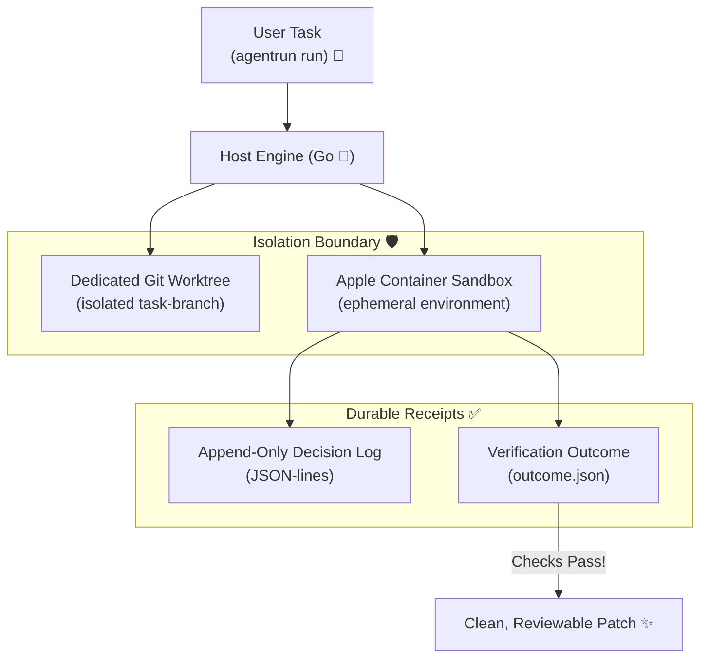

autonomous coding agents are so much fun to hack with, but letting an LLM run raw bash commands directly in your main project folder is a little wild 😂!

all it takes is one hallucinated `rm -rf`, an unexpected port collision, or a scrambled git staging index to turn a relaxing Sunday coding session into two hours of `git reflog` emergency surgery 💀.

so i started building [AgentRun](https://github.com/autonomic-ai-dev/agentrun) 🤍!

the idea is simple: **give your AI coding agent its own cozy, isolated sandbox**. it can run commands, try wild refactors, install packages, and run tests as much as it wants. your main code, uncommitted changes, and host files stay 100% safe.

here is a fun inside look at the architecture, how we use git worktrees and Apple container sandboxes in Go, and how we keep autonomous loops bounded ✨!

---

## why running agents in your root workspace gets messy ☕

most developer agent setups suffer from three funny little failure modes:

1. **unbounded mutation:** the agent runs scripts right in your working directory. if the model makes a mistake, your active git index gets scrambled.
2. **infinite retry loops:** without clear fences, an agent can get stuck in a loop reinstalling conflicting dependencies until your token budget or API quota runs out.
3. **"trust me, it works!":** when an agent claims a task is done, there's rarely an immutable receipt showing what commands were executed and whether verification tests truly passed.

think of coding agents like energetic puppy engineers: you don't turn them loose in the production data center without supervision! you give them a cozy playpen with toys, strict compilers, and lots of guidance 🚀!

---

## architecture: how the sandbox works 🚢



---

## 1. isolated git worktrees: no messy branches 🌳

instead of checking out branches directly in your active project directory, AgentRun creates a dedicated **git worktree** in a temporary folder:

```bash
git worktree add /tmp/agentrun-task-123 feature-branch
```

your editor stays untouched on whatever branch you were already working on. the agent works in its own separate folder, edits files there, and commits changes. if the agent does something silly or gets stuck? you simply delete the temporary worktree in 1 millisecond. your working tree never even flinched 🤍!

---

## 2. native Apple container isolation 🍏

on macOS, virtualization shouldn't require heavy hypervisors or slow virtualization engines.

AgentRun drives Apple's native `container` CLI:
- **ephemeral networking:** tasks bind to a private local subnet (`spike-net-*`), preventing lateral access to your local network.
- **isolated mounts:** only the task's dedicated git worktree is mounted into the container. your SSH keys, AWS credentials, and home folder are completely invisible to the agent!
- **clean teardown:** signal handlers ensure that even if a task is cancelled, the container and mounts vanish cleanly.

---

## 3. bounded verification loops: prove it first! ✨

one of our golden rules is that an agent cannot simply declare success — it must **prove** it with a real check:

```go
type Check struct {
    Name    string   `json:"name"`
    Command []string `json:"command"`
    Timeout time.Duration `json:"timeout"`
}
```

AgentRun runs the test suite inside the sandbox. if the check exits `0`, the task is marked as verified, and a clean, reviewable git patch is prepared for you to review and merge whenever you're ready.

no surprises, no scrambled git history, just clean code ready for your thumbs-up 🤍!

---

## wrapping up

giving agents their own isolated playground makes autonomous coding feel so much more relaxing. you can kick off a task, sip your coffee, and know your workstation is completely safe ☕.

the code is open source at [github.com/autonomic-ai-dev/agentrun](https://github.com/autonomic-ai-dev/agentrun).

what's your favorite way to keep autonomous tools safe? let me know in the replies 🤍!
