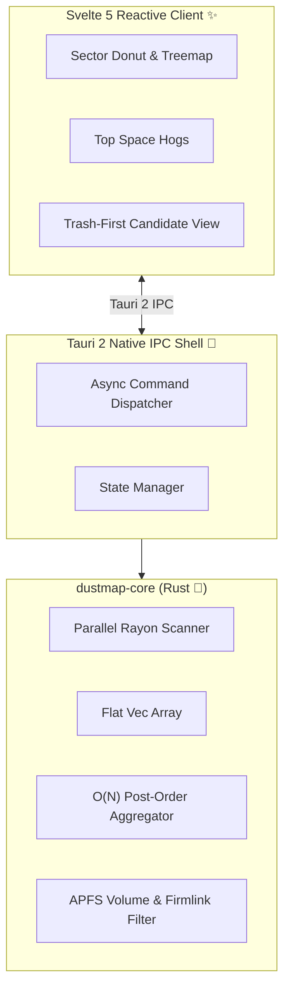

every Mac user eventually hits the exact same hilarious wall 💀:

macOS displays 120GB consumed by mysterious "System Data", the built-in storage settings give you zero helpful details, and existing disk cleanup apps either want a $40/year subscription or feel terrifyingly aggressive about what they delete!

so over a couple of fun weekends, i built [DustMap](https://github.com/abhiudayg/dustmap) 🤍!

it's a fast, transparent, 100% offline macOS disk space visualizer and conservative cleaner built with **Rust**, **Tauri 2**, and **Svelte 5**. it scans 85,000 files in under 12 milliseconds, draws interactive sector donuts and treemaps at 60 FPS, and treats your files with gentle respect.

here is the fun story behind how we built it — from parallel Rayon file walking to flat memory arrays with zero pointer chasing ✨!

---

## why traversing macOS filesystems is surprisingly tricky 👀

scanning a modern Mac drive sounds simple on paper, but APFS has a few fun quirks:

1. **firmlinks & synthetic loops:** modern macOS separates the read-only system volume from the writable data volume (`/System/Volumes/Data`), tying them together with APFS "firmlinks". a naive recursive loop will either double-count files or spin in an infinite loop!
2. **logical size vs real allocated blocks:** sparse files, compression, and APFS clone-on-write snapshots mean `file_size` rarely matches what is actually eating your SSD blocks.
3. **pointer bloat:** indexing 3,000,000 files in traditional pointer-heavy trees (`struct Node { children: Vec<Box<Node>> }`) fragments your RAM and quickly burns 500MB of memory just sitting there.

---

## architecture at a glance 🚢

DustMap splits into a featherlight Rust core and a snappy Svelte 5 UI:



---

## 1. parallel work-stealing with Rayon 🚀

on modern Apple Silicon NVMe drives, single-threaded directory walking leaves massive disk bandwidth on the table.

we built the scanner using `rayon`'s work-stealing pool:

```rust
pub fn scan_volume_parallel(
    root: &Path,
    cancel_token: Arc<AtomicBool>,
    progress_tx: Sender<ScanProgress>,
) -> Result<FlatTreeIndex> {
    let mut builder = FlatIndexBuilder::new();
    
    rayon::scope(|s| {
        traverse_directory(root, &builder, &cancel_token, &progress_tx, s);
    });

    builder.build_and_aggregate()
}
```

- **firmlink pruning:** before recursing, we check the APFS mount table and filter out synthetic junctions (`/System/Volumes/Data/Users` vs `/Users`).
- **instant cancellation:** you can pause or abort a scan at any millisecond with an `Arc<AtomicBool>`.
- **smooth progress:** a bounded channel streams progress updates to the Svelte UI so the animation stays buttery smooth at 60 FPS without overloading the IPC bridge ✨!

---

## 2. zero pointer chasing: the flat array index 🧠

in our first prototype, scanning a 2TB drive consumed **over 450MB of RAM** because of traditional pointer-based tree nodes.

we threw away the pointers and replaced the whole tree with a single, contiguous `Vec<Entry>`:

```rust
#[derive(Copy, Clone, Debug, PartialEq, Eq, Hash)]
pub struct EntryId(pub u32);

pub struct Entry {
    pub id: EntryId,
    pub parent_id: Option<EntryId>,
    pub name: CompactString,
    pub logical_size: u64,
    pub allocated_size: u64,
    pub flags: EntryFlags,
    pub first_child: Option<EntryId>,
    pub next_sibling: Option<EntryId>,
}
```

this one change was pure magic:
- **zero heap fragmentation:** everything lives sequentially in one pre-allocated buffer.
- **cache locality:** iterating through folders is blazing fast because your CPU prefetcher loves linear arrays.
- memory usage dropped from **450MB down to ~48MB** for 2.5 million indexed files 🤍!

---

## 3. real allocated blocks, not theoretical bytes 📊

macOS utilities often show raw logical file sizes. but if you have a 10GB sparse file where only 400MB has actually been written, claiming you freed 10GB is confusing!

DustMap queries `stat.st_blocks * 512` directly on macOS:

$$
\text{Allocated Bytes} = \text{st\_blocks} \times 512
$$

this guarantees that when DustMap tells you a folder takes 20 GB of storage, deleting it gives you back exactly 20 GB of free space on your drive.

---

## 4. the trash-first safety promise 🤍

we've all used reckless cleaners that promise to "speed up your Mac" and accidentally delete your local developer databases or Xcode tooling.

in DustMap:
1. **Trash first, always:** every deletion candidate moves to the native macOS Trash (`com.apple.finder`). nothing is permanently destroyed without your explicit confirmation.
2. **transparent rules:** every rule is written in friendly TOML describing *what* it does and *why* it can be safely regenerated:

```toml
[rules.xcode_derived_data]
id = "xcode-derived-data"
category = "Developer"
description = "Xcode build cache and intermediate indexing artifacts."
regenerable = true
paths = ["~/Library/Developer/Xcode/DerivedData/*"]
safety_level = "safe"
```

3. **append-only audit trail:** every action is written to a clean local JSON log. you can see exactly what was moved and when.

---

## give it a spin 🚢

DustMap 1.0 is completely open-source and free on GitHub, and you can install it via Homebrew:

```bash
brew tap abhiudayg/dustmap
brew install --cask dustmap
```

hope it helps you reclaim some disk space and brings a smile to your setup 🤍!

all code is at [github.com/abhiudayg/dustmap](https://github.com/abhiudayg/dustmap). let me know what you think in the replies ✨!
