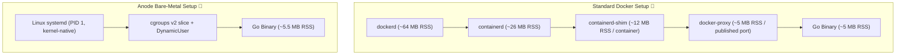

the joy of running Go straight on bare metal is honestly unmatched ✨

for years, standard industry wisdom told us we had to declare our architecture twice every single time we wanted to ship a service:

1. **in Go:** you call `sql.Open("postgres", cfg.DBURL)`, listen on `cfg.Port`, and dial your other little services.
2. **in Docker & YAML:** you write a multi-stage Dockerfile, a 50-line `docker-compose.yml`, mount host volumes, configure bridge networks, pray port 5432 isn't already taken by another project, and manually wire environment variables.

and when you change an environment variable on a Friday afternoon? your code and your yaml immediately drift apart 💀.

plus, on friendly little €3.79/month VPS boxes (like a Hetzner instance or a $4 DigitalOcean droplet), running a whole container daemon stack eats up your most precious asset: **memory**.

so i had a blast building [Anode](https://github.com/abhiudayg/anode) ([anode.abhiudayg.dev](https://anode.abhiudayg.dev)) 🤍! it's a bare-metal orchestrator that reads your Go code, figures out which databases and ports you need using the Go compiler itself, and deploys each service as a systemd unit.

here's what we measured when we ran the same Go binary three ways. earlier drafts of this post had numbers we never measured, so this version keeps only what we ran, with the method below. short version: a go service under an anode systemd unit cold-starts in about 35 ms, the same binary in docker takes about 600 ms, and one idle service costs about 5.5 MB under anode against about 100 MB of docker daemons.

---

## the illusion of container lightness for compiled binaries

docker was originally created to solve the messy dependency matrix of interpreted languages: python virtualenvs, ruby gem paths, and the legendary `node_modules` black hole. for those ecosystems, packing a miniature linux userland into an image made sense.

but Go completely changed the game. Go compiles down to a single, self-contained, statically linked machine binary (`CGO_ENABLED=0`). it has no runtime VM dependencies, no dynamic shared library lookups, and no interpreter overhead.

yet we still wrap that binary inside a container daemon supervisor stack:



the neat secret? the linux kernel already provides every isolation feature docker uses: `cgroups v2` for cpu and memory limits, unprivileged users for security, and `systemd` for process supervision and restarts. wrapping a static Go binary in a container shim adds a daemon stack on top of that without adding anything the binary needs.

---

## cold starts: 4.7 ms, 35 ms, 607 ms

how we timed it: the clock starts when the service or container is started, and stops when `GET /healthz` returns `200 OK`. page caches are dropped before every run. ten runs per arm, medians shown.

| how the binary starts | median | range |
|---|---:|---:|
| run directly, no supervisor | 4.7 ms | 3.7 to 6.9 ms |
| bare systemd unit (`ExecStart` only) | 11.1 ms | 9.9 to 17.2 ms |
| anode unit, without `DynamicUser` | 12.0 ms | 11.1 to 15.7 ms |
| anode unit as deployed | 34.9 ms | 31.9 to 36.8 ms |
| docker container (`docker run -d`) | 607 ms | 592 to 914 ms |

the 8 ms figure from our first draft is close to a direct process start on this machine (4.7 ms). through an anode unit, we measured 35 ms, and the gap is worth understanding:

- systemd itself adds about 6 ms over a direct start.
- the sandbox directives in the anode unit (namespaces, read-only system, no capabilities) add about 1 ms.
- `DynamicUser=yes` adds about 20 ms. systemd allocates a dynamic user on every start, and that is the expensive part.

anode keeps `DynamicUser` because its isolation rules require a per-service unprivileged user. so the honest number for an anode-managed service is about 35 ms. dropping `DynamicUser` for a fixed system user would bring the unit path down to about 12 ms, but it weakens the isolation model, so we haven't made that change.

we didn't break the docker path down further in this post, so the 607 ms is a total, not a per-step breakdown.

---

## idle memory: about 5.5 MB against about 100 MB

we measured resident memory (RSS) 20 seconds after the service passed its health check, with each arm running alone. the same binary runs in both.

| process | docker stack 🐳 (host networking) | anode bare-metal 🚀 |
|---|---:|---:|
| `dockerd` | 63.6 MB | *none* |
| `containerd` | 25.7 MB | *none* |
| `containerd-shim` (one per container) | 11.8 MB | *none* |
| `docker-proxy` (only when a port is published) | *not used with host networking* | *none* |
| your Go service | 5.3 MB | 5.5 MB |
| **total** | **~106 MB** | **~5.5 MB** |

that table is from one run. across two runs the docker total came out between 102 and 106 MB, so "about 100 MB" is the honest summary. with bridge networking and a published port, `docker-proxy` adds another 4.6 MB per port.

we measured one service with no database. we have not measured what a multi-service stack looks like on either side yet.

---

## the unit anode generates

instead of hand-writing systemd configs, anode reads your Go code's call graph and generates the unit. this is the one we ran for the measurements above, trimmed to the directives that matter here:

```ini
[Unit]
Description=Anode hello (release ...)
After=network.target

[Service]
Type=simple
DynamicUser=yes
StateDirectory=hello
ExecStart=/var/lib/anode/releases/<release>/hello
Restart=always
RestartSec=3
Environment="PORT=21040"

# cgroups v2 resource limits
CPUQuota=200%
MemoryMax=1G

# kernel hardening
NoNewPrivileges=true
ProtectSystem=strict
ProtectHome=true
PrivateTmp=true
CapabilityBoundingSet=
RestrictNamespaces=true
MemoryDenyWriteExecute=true
```

every service gets its own ephemeral user ID with read-only access to `/usr` and `/etc`. even if an attacker finds a remote exploit in your app, they can't touch the host filesystem.

---

## how we measured

- hardware: OrbStack Debian 12 VM on an Apple Silicon Mac (arm64), 7 vCPU, 8 GB RAM.
- software: Docker 20.10.24, anode 1.6.0, systemd on Debian 12.
- the binary: the same static Linux build in every arm, produced by `anode deploy`.
- readiness: a TCP connection followed by an HTTP `GET /healthz` that must return `200`, polled with bash's microsecond clock.
- the docker arm uses plain `docker run` defaults, with no memory limit and no extra hardening. the anode unit has the limits and hardening shown above.
- limits: one VM, one service, no database, and one laptop. the raw scripts and runs are kept alongside the anode benchmark notes.

---

## zero-downtime deploys with Caddy 🚢

a question friends often ask is: *"how do you roll out updates without kubernetes or docker swarm?"*

Anode pairs systemd with Caddy's dynamic admin API:

1. Anode builds your static binary locally (`CGO_ENABLED=0 GOOS=linux`) and streams it over SSH to a new release directory.
2. it starts the new version under a temporary systemd unit on a local loopback port.
3. it pings your `/healthz` endpoint. once it returns 200 OK, the new version is considered healthy.
4. Caddy swaps the reverse proxy route to the new version.
5. the old version gets a `SIGTERM`, finishes serving its in-flight requests, and exits.

we haven't measured the route-swap time or the number of dropped connections yet, so this post doesn't put a number on it.

---

## wrapping up & what's next

building Anode made programming for the cloud feel fun again ✨. no yaml manifests, no daemon crashes, just fast binaries running happily on linux.

Anode is 100% open-source under MIT at [github.com/abhiudayg/anode](https://github.com/abhiudayg/anode), and you can check out the docs and guides at [anode.abhiudayg.dev](https://anode.abhiudayg.dev).

in Part 2, we're going to dive inside Anode's compiler core: how Go SSA analysis and backward taint tracking figure out your entire database schema and route table. on the sample apps in the repo, that analysis takes about a second (1.1 s for a two-service app, 8.8 s for a 32-service one).

what are you shipping this week? let me know in the replies 🤍!
