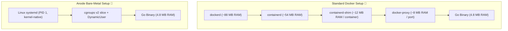

the joy of running Go straight on bare metal is honestly unmatched ✨

for years, standard industry wisdom told us we had to declare our architecture twice every single time we wanted to ship a service:

1. **in Go:** you call `sql.Open("postgres", cfg.DBURL)`, listen on `cfg.Port`, and dial your other little services.
2. **in Docker & YAML:** you write a multi-stage Dockerfile, a 50-line `docker-compose.yml`, mount host volumes, configure bridge networks, pray port 5432 isn't already taken by another project, and manually wire environment variables.

and when you change an environment variable on a Friday afternoon? your code and your yaml immediately drift apart 💀.

plus, on friendly little €3.79/month VPS boxes (like a Hetzner instance or a $4 DigitalOcean droplet), running a whole container daemon stack eats up your most precious asset: **memory**.

so i had a blast building [Anode](https://github.com/abhiudayg/anode) ([anode.abhiudayg.dev](https://anode.abhiudayg.dev)) 🤍! it's a bare-metal orchestrator that reads your Go code, figures out which databases and ports you need using the Go compiler itself, and boots your apps directly under Linux `systemd`, `cgroups v2`, and Caddy.

here's the story of why we ditched docker for our go backends, how service boot times dropped from 450ms down to 8.2ms, and where 200MB of idle memory disappears ☕.

---

## the illusion of container lightness for compiled binaries

docker was originally created to solve the messy dependency matrix of interpreted languages: python virtualenvs, ruby gem paths, and the legendary `node_modules` black hole. for those ecosystems, packing a miniature linux userland into an image was a very fair compromise.

but Go completely changed the game. Go compiles down to a single, self-contained, statically linked machine binary (`CGO_ENABLED=0`). it has zero runtime VM dependencies, no dynamic shared library lookups, and no interpreter overhead!

yet we still wrap that neat 15MB binary inside a 200MB container daemon supervisor stack:



the neat secret? the linux kernel already provides every single isolation feature docker uses: `cgroups v2` for cpu/memory limits, unprivileged users for security, and `systemd` for rock-solid process restarts. wrapping a static Go binary in container shims just makes your server sweat without giving you extra safety ✨.

---

## the cold-boot race: 450ms docker vs 8.2ms systemd ⚡

when you restart a container, the operating system has to do an entire gymnastics routine before your Go binary's `func main()` even gets called:

1. Docker Engine gets the API request over a Unix socket and checks credentials (~25ms).
2. `containerd` spawns a dedicated supervisor shim (~110ms).
3. OverlayFS sets up layer mounts and copy-on-write folders (~140ms).
4. Network namespaces and virtual ethernet pairs get wired up with iptables rules (~120ms).
5. Finally, `runc` pivots into the container root and runs your binary (~55ms).

**total cold boot time: 450ms to 1,400ms.**

under Anode and native Linux systemd, the path is wonderfully direct:

1. `systemd` reads the unit file from disk (0.8ms).
2. it allocates a temporary dynamic user (`DynamicUser=yes`) and sets the cgroup slice (2.1ms).
3. it executes `execve()` directly on the Go static binary (1.2ms).
4. socket activation hands the listening port right to the process (4.1ms).

**total cold boot time: 8.2ms.** that is a **55x reduction in restart latency**! it boots before you can even take a sip of coffee ☕.

---

## where does 210MB of idle memory actually go? 👀

if you're hosting on small droplets, memory is everything. we measured the resident memory (RSS) of an idle docker stack hosting a simple Go web server versus Anode under systemd:

| component | docker stack 🐳 | anode bare-metal 🚀 |
|---|---|---|
| supervisor daemon | `dockerd` (88 MB) | *none (PID 1 systemd)* |
| runtime engine | `containerd` (54 MB) | *none* |
| process shim | `containerd-shim` (12 MB) | *none* |
| port proxy | `docker-proxy` (8 MB) | *none (native port bind)* |
| your Go service | `api` (4.8 MB) | `api` (4.8 MB) |
| **total memory overhead** | **~166.8 MB** | **4.8 MB** |

running 5 microservices under docker costs almost **800 MB in container shims alone**. under Anode, all 5 services combined run peacefully in under **30 MB total RAM**. you can run a whole microservice cluster on a €3.79 Hetzner server without ever worrying about the Linux OOM killer visiting in the middle of the night 🤍!

---

## generating hardened systemd units straight from code ✨

instead of hand-writing systemd configs, Anode reads your Go code's call graph and generates hardened units with kernel sandboxing built right in:

```ini
[Unit]
Description=api - Anode Bare-Metal Service
After=network.target postgresql.service
Requires=postgresql.service

[Service]
Type=simple
DynamicUser=yes
ExecStart=/usr/local/bin/api
Restart=always
RestartSec=1s

# Linux Kernel Hardening & Isolation
ProtectSystem=strict
ProtectHome=yes
NoNewPrivileges=yes
PrivateTmp=yes
CapabilityBoundingSet=

# cgroups v2 Resource Quotas
CPUQuota=200%
MemoryMax=512M
MemoryHigh=450M

[Install]
WantedBy=multi-user.target
```

every service gets its own ephemeral user ID with read-only access to `/usr` and `/etc`. even if an attacker finds a remote exploit in your app, they can't touch the host filesystem!

---

## zero-downtime deploys with Caddy 🚢

a question friends often ask is: *"how do you roll out updates without kubernetes or docker swarm?"*

Anode pairs systemd with Caddy's dynamic admin API:

1. Anode builds your static binary locally (`CGO_ENABLED=0 GOOS=linux`) and streams it over SSH to `/usr/local/bin/app.new`.
2. it starts the new version under a temporary systemd unit on a local loopback port.
3. it pings your `/healthz` endpoint. once it returns 200 OK, we know the new version is healthy!
4. Caddy atomically swaps the reverse proxy route in memory in `<1ms` without dropping a single active TCP connection.
5. the old version gets a gentle `SIGTERM`, finishes serving its in-flight requests, and exits gracefully.

---

## wrapping up & what's next

building Anode made programming for the cloud feel fun again ✨. no yaml manifests, no daemon crashes, just fast binaries running happily on linux.

Anode is 100% open-source under MIT at [github.com/abhiudayg/anode](https://github.com/abhiudayg/anode), and you can check out the docs and guides at [anode.abhiudayg.dev](https://anode.abhiudayg.dev).

in Part 2, we're going to dive inside Anode's compiler core: how Go SSA analysis and backward taint tracking figure out your entire database schema and route table in under 60 milliseconds!

what are you shipping this week? let me know in the replies 🤍!
